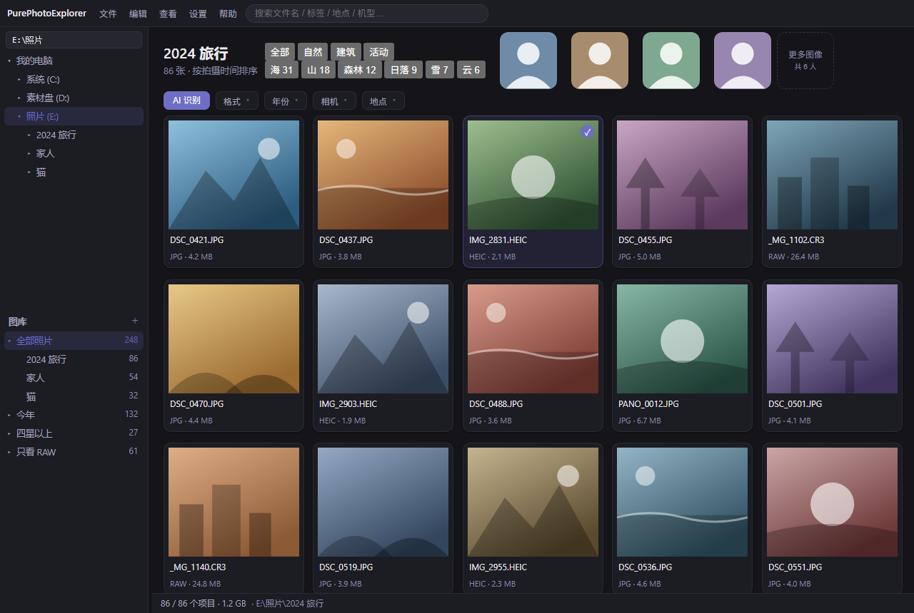
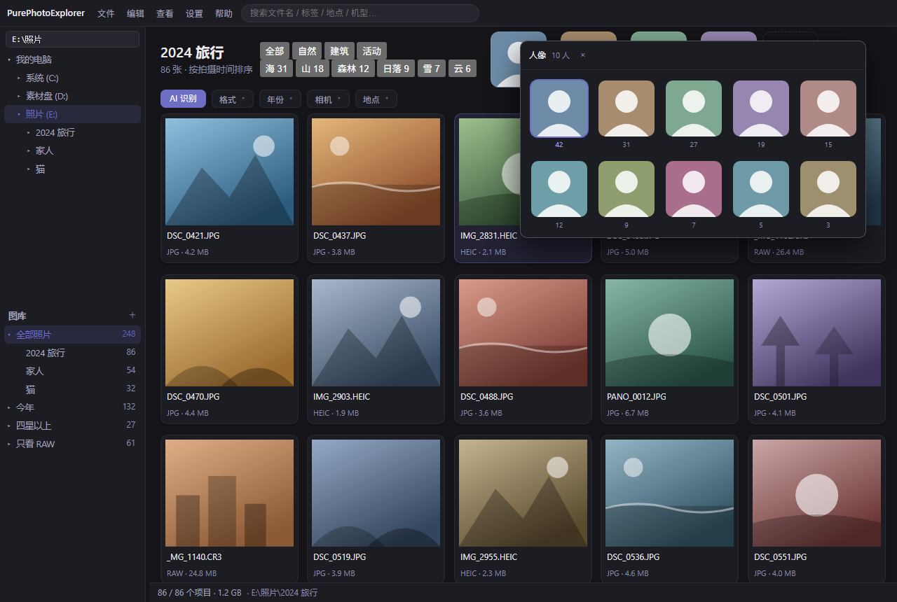
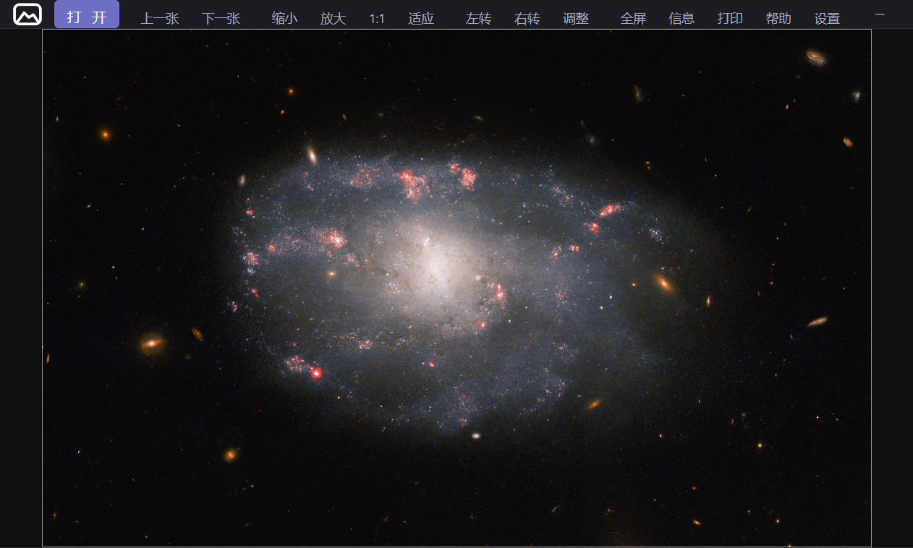

# PurePhotoExplorer

> 多格式图像浏览与本地照片管理器 · Windows 桌面版 · Rust + Tauri 2 + React
>
> **当前版本：`1.0.0 Beta`**（`v1.0.0` 起）

PurePhotoExplorer 是一个轻量、快速的本地图片浏览器、编辑器与照片管理器。
**解码链全部用纯 Rust 实现，无 C 依赖**；**所有数据留在本机，不联网、不上传**。绿色免安装。



<sub>截图中的照片为示意占位图；界面是人像/标签功能的真实布局。</sub>

---

## 图库模式：把散落的照片变成能搜的库

照片散在几个盘、几十个文件夹里也没关系。左边选范围，中间看图，右下角看统计。

### 浏览 ≠ 入库（这条最重要）

| 动作 | 发生什么 |
| --- | --- |
| **左键**点文件夹 | 只是**预览**：列目录、临时解码缩略图。不写索引、不生成缓存，所以搜不到、也打不了标签 |
| **右键 → 加入图库** | 才是**登记**：遍历、算指纹、写进 SQLite 索引，之后能搜索 / 筛选 / 打标 / 认人 |
| 把文件夹**拖到**左侧图库名上 | 一步到位，等于「加入图库」 |

这么分是因为「随手看一眼」是高频动作，不该每次都往索引里塞几百条记录。

### 建库与组织

- **多图库**：一个图库可以挂多个目录；同一张照片也可以出现在多个图库里
- **智能图库**：不占空间，按规则实时算 —— 今年 / 本月 / 四星以上 / 只看 RAW / 按年份
- **侧栏**：上半是「我的电脑」文件树（懒加载 + 地址栏直接敲路径），下半是图库列表（带张数）
- **卷身份**按磁盘 GUID + 相对路径记，**不认盘符** —— 移动硬盘今天 `D:` 明天 `E:`，库不会散

### 查找

- **搜索**：文件名 / 标签 / 地点 / 相机品牌 / 机型 / 镜头，空格分隔多个词 = 都要命中
- **筛选**：格式、年份、相机、地点四个下拉，可叠加
- **排序**：拍摄时间（默认，没有 EXIF 时间的用入库时间兜底）、文件名、大小、修改时间

### 批量操作

评分、旗标、旋转翻转、重命名（模板 `{name}` / `{n}`）、另存为、转格式、
按 EXIF 摆正、复制 / 移动到文件夹、打印、删除（**进回收站，不是直接抹掉**）。

---

## 本地 AI：自己认得出拍的是什么

模型随包附带（约 200 MB），**全部在本机推理，断网可用，照片不上传**。

### 智能标签

用 CN-CLIP 做零样本分类：111 条两级中文词表（一级类目 → 二级标签），
一张图算出 512 维向量后与词表比对，**单张约 0.43 秒**。

- 两级钻取：`自然 / 建筑 / 活动 / 艺术` 下挂 `海 / 山 / 日落 / 街景 / 古迹 / 绘画`…
- 阈值 0.39（二级）/ 0.35（一级），一张图最多 6 个标签
- 标签条直接当筛选器用：点「海」就只剩带海景的 31 张
- 手动打的标签和 AI 打的标签分开记，互不覆盖

### 人脸识别

YuNet 检测（2048 长边、最小脸 56px）+ SFace 提取 128 维特征，再用**两阶段聚类**归人：

```
① 高门槛 0.55 先聚出「绝对是同一个人」的核心簇（宁可漏，不可错）
② 剩下的散脸按与簇心的相似度 > 0.50 并入
```

单阈值切不开 —— 同一个人正脸侧脸相似度在 0.45~0.95 波动，不同的人也可能到 0.55，
两拨分数重叠。只有 ≥3 张脸的簇才建成「人物」，避免误检干扰。



<sub>人像为示意剪影。点人像条上的「更多图像」打开这面墙，点某个人就筛出他的全部照片。</sub>

---

## 单图浏览



- **多格式支持**：JPEG / PNG / GIF（动图）/ WebP（动图）/ HEIC / HEIF / BMP / TIFF / AVIF / PSD
- **相机 RAW**：CR3 / DNG / NRW / RAF / RW2 / ORF / SR2 / SRF（读取内嵌预览，秒开）
- **流畅浏览**：大图预览档解码优化（22 MB / 5847×3898 约 218 ms）、滚轮翻页、全屏、胶片条
- **非破坏性编辑**：旋转 / 裁剪 / 8 种固定比例，可另存（覆盖保存会搬运原拍摄参数）
- **EXIF 信息**、拍摄地点（离线地名库，**不联网**）、打印、文件关联

---

## 支持格式

| 类别 | 扩展名 |
| --- | --- |
| 位图 | `jpg` `jpeg` `png` `bmp` `gif` `webp` `tif` `tiff` `avif` |
| 手机 / 苹果 | `heic` `heif` |
| 设计稿 | `psd`（合成图） |
| 相机 RAW | `cr3` `dng` `nrw` `raf` `rw2` `orf` `sr2` `srf` |
| 压缩包 | 直接浏览 `zip` `cbz` `7z` `rar` `cbr` `cb7` 里的图片 |

> 格式判定只看魔数，不看扩展名。RAW 仅读取内嵌 JPEG 预览，**不支持写回原文件**。
> 可写格式仅 `jpg/jpeg/png/bmp`。

## 下载

前往 [Releases](https://github.com/JustFc666/PurePhotoExplorer/releases) 下载。

运行要求：

- Windows 10 1809+ / Windows 11
- WebView2 Runtime（Win10/11 一般已内置）
- 磁盘：程序 + AI 模型约 280 MB

### 两种版本，区别只在数据放哪

| 版本 | 数据目录 | 适合 |
| --- | --- | --- |
| 安装版（`..._x64-setup.exe`） | `%LOCALAPPDATA%\PurePhotoExplorer` | 装在本机长期用，注册图片「打开方式」 |
| 绿色版（`..._portable.zip`） | 解压目录下的 `data\` | 放 U 盘、换电脑、不想装 |

绿色版靠 exe 旁边一个空的 `portable` 文件识别：**整个文件夹拷走就是搬家**，
索引、缩略图、人脸向量都跟着走。删掉这个文件，程序就回到安装版的行为。

## 构建

前置：Rust 1.77+、Node 18+、`nasm`（AVIF 解码需要，需加进 PATH）。

```bash
cd apps/desktop && npm install && npm run build
cd ../.. && cargo build --release
# 产物：target/release/photovault.exe
# 发布时再改名为 PurePhotoExplorer.exe（crate 名沿用 photovault，未改）
```

打绿色版（一条命令，自动带上模型、DirectML.dll 与 7z）：

```bash
python scripts/pack_portable.py
# 产物：release/PurePhotoExplorer_<版本>_win64_portable.zip
```

> ⚠️ 改过 `apps/desktop/src-tauri/tauri.conf.json` 之后，必须先
> `touch apps/desktop/src-tauri/{build.rs,tauri.conf.json,src/main.rs}` 再构建。
> ⚠️ 挪动过工程目录的话，先 `rm -rf target/release/build/tauri-*`，否则会读到旧的绝对路径。

## 技术栈

- **后端**：Rust workspace，13 个 crate
  `pv-core` / `pv-decode` / `pv-meta` / `pv-cache` / `pv-index` / `pv-vault` /
  `pv-edit` / `pv-ai` / `pv-geo` / `pv-scan` / `pv-store` / `pv-lib` / `pv-archive`
- **AI**：ONNX Runtime + DirectML（CN-CLIP / YuNet / SFace）
- **前端**：React 18 + TypeScript + Vite
- **外壳**：Tauri 2（无边框全自绘窗口）

## 文档

| 文档 | 内容 |
| --- | --- |
| [docs/项目历程与踩坑总结.md](docs/项目历程与踩坑总结.md) | **接手先读**：25 天做了什么、哪些方案已被推翻、踩过哪些坑 |
| [docs/给同学讲的架构说明.md](docs/给同学讲的架构说明.md) | 面向非技术读者的架构、算法与工程纪律（配两张图解） |
| [docs/代码地图-文件功能与算法.md](docs/代码地图-文件功能与算法.md) | 每个文件负责什么、用了什么算法；附算法反查表 |
| [docs/S1使用说明.md](docs/S1使用说明.md) | 单图浏览怎么用 |
| [docs/S2使用说明.md](docs/S2使用说明.md) | 图库模式怎么用 |
| [docs/S2图像资源管理器开发手册.md](docs/S2图像资源管理器开发手册.md) | 图库模式开发手册（架构 / 数据模型 / UI 规范） |
| [docs/开发顺序规划.md](docs/开发顺序规划.md) | 阶段划分与当前进度 |
| [docs/README.md](docs/README.md) | 全部文档索引 |

## 许可

本项目采用 [MIT](LICENSE) 许可。

第三方署名：

- 离线地名数据来自 [GeoNames](https://www.geonames.org/)，**CC BY 4.0**
- 人脸模型：YuNet（MIT）、SFace（Apache-2.0）
- 打标模型：CN-CLIP（中文原生零样本）

> 本文档中的截图用于说明界面结构与功能位置，照片素材为示意占位图，不含任何真实个人影像。
