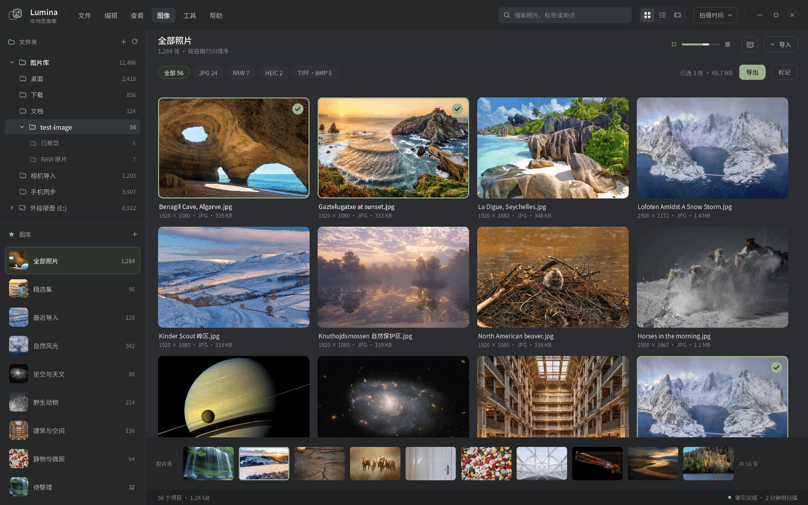

# S2 图像资源管理器 开发手册

| 项目    | 内容                                                                                                                                                     |
| ----- | ------------------------------------------------------------------------------------------------------------------------------------------------------ |
| 文档版本  | **v0.3**（2026-10-24 补齐实现侧定稿：标签条 / 筛选下拉 / 多选规则 / 原地重命名 / 最小窗口）                                                  |
| 阶段代号  | **S2 —— 图像资源管理器（Image Library Manager）**                                                                                                               |
| 对标产品  | Google Picasa（本地图库管理范式）                                                                                                                                |
| 命名    | ✅ **已定稿（2026-10-14）**：产品名统一 **PurePhotoExplorer**，S2 = 它的「**图库模式**」(Library Mode)；`PhotoVault` 仅作**内部代号**（crates 前缀 `pv-*`）；设计稿占位名 `Lumina` 弃用。详见 §0.3 |
| 宿主壳体  | 与 S1 同一 Tauri 2 应用（见 §2.1 决策 D1）                                                                                                                       |
| 核心技术栈 | Tauri 2 + Rust（workspace）+ React 18 + TypeScript + SQLite(FTS5)                                                                                        |
| 目标规模  | **万级图库**（1 万张量级，沿用开发文档口径），单目录 10 万文件不掉帧                                                                                                                |
| 第一原则  | 效率与稳定优先，功能其次                                                                                                                                           |
| 依赖前置  | S1 单图浏览 ✅ 已完成；S0 地基 ✅ 已完成                                                                                                                              |
| 文档日期  | 2026-10-14（v0.2）→ **2026-10-24（v0.3，实现侧定稿）**                                                                                                        |

> 本手册与《图像浏览软件开发文档》v1.1、《开发顺序规划》配套。**FR 编号沿用既有体系**：本手册新增需求从 `FR-S2.x` 起编，避免与 R1–R6 冲突。

---

## 0. 文档导读

### 0.1 设计稿



设计稿把界面划分为 8 个区域，本手册 §3 逐区给出规范：

| # | 区域                        | 手册章节         |
| - | ------------------------- | ------------ |
| 1 | 菜单栏                       | §3.1 / §11   |
| 2 | 按文件夹索引区（资源管理器式目录树）        | §3.2         |
| 3 | 按指定图库索引区（一个或多个文件夹组成图库）    | §3.3         |
| 4 | 图库浏览区（可调缩略图尺寸，双击启动单图浏览）   | §3.4         |
| 5 | 搜索框                       | §3.5 / §9    |
| 6 | 图像缓存 + AI 图像分析（关键字）+ 加密图库 | §6 / §7 / §8 |
| 7 | 搜索（关键字 / 时间 / 拍摄地点…）      | §9           |
| 8 | 菜单栏常用功能清单                 | §11          |

### 0.2 S2 在整体规划中的位置

```
S0 地基 ──┬─> S1 单图浏览 ✅ ──┬─> S2 资源管理器（本手册）──> S7 AI 检索
          │                    ├─> S4 编辑 ──> S5 批量 ──> S8 RAW 开发
          └─> S6 加密 ─────────┘（S6 与本手册 §7「加密图库」合并落地）
```

S2 是当前**唯一瓶颈**：所有下游（AI 检索、批量操作）都依赖它的索引与筛选能力。

### 0.3 ✅ 关键决策（Q1–Q6 已于 2026-10-14 全部定稿）

| 编号     | 问题        | 选项                                                             | 本手册倾向                                                                                                                                                                            |
| ------ | --------- | -------------------------------------------------------------- | -------------------------------------------------------------------------------------------------------------------------------------------------------------------------------- |
| **Q1** | 模块/产品命名   | ① 模块代号 `PhotoVault` ② 设计稿占位 `Lumina` ③ 统一用 `PurePhotoExplorer` | ✅ **已定稿（2026-10-14）**：③ —— 产品名统一 `PurePhotoExplorer`，S2 为其「图库模式」；`PhotoVault` 退为内部代号，`Lumina` 弃用                                                                                 |
| **Q2** | 加密图库的实现形态 | ① **容器收纳** ② **就地加密**                                          | ✅ **已定稿（2026-10-14）**：① 容器收纳的「**就地容器**」变体 + **可自救设计**（R-V1~R-V8），详见 §7.3                                                                                                         |
| **Q3** | 本地 AI 模型  | ① `Ollama` ② `llama.cpp server` ③ 都支持                          | ✅ **已定稿（2026-10-14）**：主接口 = **OpenAI 兼容端点**（`base_url`+`model`），Ollama / llama.cpp / LM Studio / vLLM 通吃；另加**适配层**兜底 vision / JSON / 向量差异；**云端大模型按 API Key 配置接入**（§8.2.1 / §8.7） |
| **Q4** | 图库与文件的关系  | ① 纯视图 ② 复制进库 ③ 移动进库                                            | ✅ **已定稿（2026-10-14）**：① **纯视图**——不复制 / 不移动文件；删图库只删定义，绝不动文件                                                                                                                       |

> Q5（顶栏实现）、Q6（人脸聚类）见 §15.2 —— **Q1–Q6 已于 2026-10-14 全部定稿**。

---

## 1. 目标与定位

### 1.1 对标 Picasa 的能力差距

| 能力              | Picasa      | 本项目 S1（现状） | S2 目标               |
| --------------- | ----------- | ---------- | ------------------- |
| 目录树浏览           | ✅           | ❌          | ✅                   |
| 缩略图网格 + 虚拟滚动    | ✅           | ❌          | ✅（10 万文件不掉帧）        |
| 图库 / 相册（跨文件夹集合） | ✅（相册）       | ❌          | ✅（图库）               |
| 双击进入单图浏览        | ✅           | 只有自身       | ✅ → 调用 S1           |
| 搜索（关键字/时间/地点）   | ✅           | ❌          | ✅（含 AI 关键字与 GPS 反查） |
| 人脸/场景识别         | ✅（当年）       | ❌          | ✅（本地大模型，FR-4.x）     |
| 批量操作/导出         | ✅           | 🟡 仅另存为    | ✅（S5 接）             |
| 加密私密图库          | ❌（Picasa 无） | ❌          | ✅（**本项目差异化能力**）     |

**结论**：S2 = "Picasa 的浏览与管理骨架" + "本地 AI 语义检索" + "图库级加密"三者的组合。

### 1.2 与 PurePhotoExplorer（S1）的关系

- **S1 = 单图浏览/编辑**（已有、稳定、已发布 v0.2.0）；
- **S2 = 图库管理与检索**（本手册）；
- 二者的交互边界只有一个：**S2 双击缩略图 → 打开 S1 单图浏览模式**（§10）。

### 1.3 非目标（本阶段明确不做）

- 云同步 / 账号体系；
- 多人协作与权限；
- 视频/音频管理（只做静态图像，动图 GIF/WebP 只取首帧作缩略图）；
- 图像内容编辑（属 S4/S5）。

---

## 2. 总体架构

### 2.1 决策 D1：进程与窗口模型

**问题**：把 S2 做成独立程序，还是 S1 应用内的一个模式？

**方案对比**：

| 方案                                 | 优点                             | 缺点                                     |
| ---------------------------------- | ------------------------------ | -------------------------------------- |
| A. 独立 exe（`purephotoexplorer.exe`） | 职责清晰、独立发布                      | 需复制一套 Tauri 壳与解码依赖，体积翻倍；跨程序传图/传选择要 IPC |
| B. **同一 exe，双模式**（推荐）              | 复用 S1 壳/解码/缓存/主题；双击即切模式，零跨进程开销 | 单进程内存占用略高；需设计模式切换与状态隔离                 |

**采用 B**：同一 Tauri 应用内以"**图库模式（Manager）/ 单图模式（Viewer）**"两种视图切换。双击不重启进程，而是切换到 Viewer 模式并载入该图。窗口装饰**统一为 `decorations: false` 全自绘**（A3 定稿，见 §3.1），两模式共用同一窗口与同一套窗口机制（S1 的 `win_style` / `ResizeHandles` / `useWindowDrag`）。

**进一步**：为兼顾"像独立程序"的使用习惯，保留 **CLI 直启**——`purephotoexplorer.exe --view "<path>"` 直接以单图模式打开某张图（供外部程序/文件关联调用，见 §10）。启动参数表：

| 参数                            | 行为                                     |
| ----------------------------- | -------------------------------------- |
| （无）                           | 启动进入**图库模式**（默认）                       |
| `--view <path> [--dir <dir>]` | 直接进入**单图模式**并打开 `<path>`，兄弟列表取 `--dir` |
| `--library <name>`            | 启动进入图库模式的指定图库                          |
| `--scan`                      | 无界面，触发一次索引扫描后退出（供定时任务/命令行）             |

### 2.2 复用既有 crate 映射

| 既有 crate    | S2 用途                                       | 需补的缺口                           |
| ----------- | ------------------------------------------- | ------------------------------- |
| `pv-core`   | 错误类型、magic bytes 格式探测、`RawPipeline`         | — 直接用                           |
| `pv-decode` | 解码 + **缩略图生成**（`ThumbTier`）、`probe`（取宽高/格式） | 增"仅取头快速探测"路径（网格需要，避免全解码）        |
| `pv-meta`   | EXIF 全量解析（拍摄时间/机型/镜头/GPS/朝向）                | 增**批量、低开销**读取（网格用，只取需要的字段）      |
| `pv-cache`  | **L1 内存 LRU + L2 磁盘缩略图库**                   | ⚠️ **当前是空文件**，需从头实现（§6）         |
| `pv-index`  | SQLite schema / 缓存键 / 查询                    | ⚠️ 当前仅 `cache_key`，需实现完整索引层（§4） |
| `pv-geo`    | GPS → 最近城市反查（离线地名库）                         | 增"按地点名反查 bbox"以支持 `place:` 检索   |
| `pv-vault`  | 加密容器（Argon2id + AES-256-GCM）                | 从"格式定义"落地为可用的加解密（与 §7 合并）       |
| `pv-ai`     | 图像分析、关键字、向量                                 | ⚠️ 当前是空文件，需从头实现（§8）             |
| `pv-edit`   | （S2 不直接用）                                   | —                               |

### 2.3 新增 crate

| 新 crate   | 职责                              | 说明                                        |
| --------- | ------------------------------- | ----------------------------------------- |
| `pv-scan` | 目录遍历、增量判定、文件监听（`notify`）、任务队列   | 与 `pv-index` 解耦：scan 产出"变更事件流"，index 负责落库 |
| `pv-lib`  | 图库领域模型（图库定义、成员关系、智能规则、加密图库生命周期） | 图库是 S2 特有概念，单独成 crate 便于单测                |

> - **原则一（接口先行，沿用 S0）**：`pv-scan` 的事件枚举、`pv-lib` 的图库模型必须在写 UI 前定稿，否则网格/搜索/加密都会返工。
> - **原则二（存储身份，2026-10-14）**：路径以「`volume_guid` + 相对路径」持久化，**绝不以盘符为身份**；否则移动硬盘换盘符 = 索引与缓存集体失效（§5.5）。
> - **原则三（不写用户目录，2026-10-14）**：**绝不向用户的图片文件夹写任何文件**；索引/缓存集中在数据目录，且**可配置、可迁移**（§6.3）。

### 2.4 数据流

```
文件系统 ──(pv-scan: walkdir + notify)──> 变更事件流
                                            │
                          ┌─────────────────┼──────────────────┐
                          ▼                 ▼                  ▼
                   pv-index(SQLite)   pv-cache(L1/L2)     pv-ai(分析队列)
                    元数据/标签/关系     缩略图            关键字/向量/OCR
                          │                 │                  │
                          └────────┬────────┴────────┬─────────┘
                                   ▼                 ▼
                            搜索/筛选引擎      网格/胶片条渲染
                                   │
                       双击 ──> S1 单图模式（同进程切视图）
```

---

## 3. UI 规范（对应设计稿 8 区）

### 3.0 布局总览

```
┌─────────────────────────────────────────────────────────────────────────────┐
│ [Logo] 文件 编辑 查看 图像 工具 帮助        [🔍 搜索照片、标签或地点]  ⊞≡ 拍摄时间▾ −□✕ │ 1 菜单栏 + 5 搜索框
├───────────────────┬─────────────────────────────────────────────────────────┤
│ 2 文件夹            │  全部照片 · 1,284 张 · 按拍摄时间排序          [导入]      │
│  ├ 图片库  12,486  │  [全部 56][JPG 24][RAW 7][HEIC 2][TIFF+BMP 5]           │
│  ├ 桌面     2,418  │  ┌────┬────┬────┬────┐   4 图库浏览区（网格，可调尺寸）   │
│  ├ 下载       850  │  │    │    │    │    │                                  │
│  ├ test-image  56  │  ├────┼────┼────┼────┤                                  │
│  ├ 相机导入 1,705  │  │    │    │    │    │   已选 3 张 · 48.7 MB [导出][标记] │
│  └ 外接硬盘 8,012  │  └────┴────┴────┴────┘                                  │
│ ─────────────────  │  ┌───────────────────────────────────────────────────┐  │
│ 3 图库         +   │  │ 胶片条（选中项的上下文）  共 56 张                 │  │
│  ● 全部照片 1,284  │  └───────────────────────────────────────────────────┘  │
│  ○ 精选集      96  │                                                          │
│  ○ 自然风光   342  │                                                          │
│  🔒 私密图库       │                                                          │
├───────────────────┴─────────────────────────────────────────────────────────┤
│ 56 个条目 · 1.24 GB                                    索引完成 · 2 分钟前扫描  │
└─────────────────────────────────────────────────────────────────────────────┘
```

### 3.1 区域 1：菜单栏

> **窗口尺寸约束（2026-10-24 定稿）**：主窗口**最小 1200 × 800 逻辑像素**
> （`tauri.conf.json` 的 `minWidth` / `minHeight`）。
> 标签条按「每行固定 8 个」渲染，窄窗口下会横向溢出，所以下限卡在 1200。
> ⚠️ 改完 `tauri.conf.json` 必须 `touch build.rs tauri.conf.json main.rs` 再 `cargo build`，
> tauri-build 的 `rerun-if-changed` 不可靠，不 touch 会**沿用旧值**（实测被钳在 800×600）。

- 左侧：应用图标 + 应用名（PurePhotoExplorer）。
- 中部：六个主菜单 `文件 / 编辑 / 查看 / 图像 / 工具 / 帮助`（完整功能表见 §11）。
- 右侧：视图切换（网格/列表）、排序下拉（拍摄时间▾）。
- **实现（Q5 定稿·A3 修订为 ④ 统一自绘）**：**全自绘窗口**（`decorations: false`）+ **HTML 顶栏**——logo / 菜单 / 搜索 / 视图按钮 / 排序 / 窗口按钮 `− ☐ ✕` 全部自绘在内容顶行；**复用 S1 的窗口机制**（`win_style.rs` / `ResizeHandles` / `useWindowDrag`），菜单用 **HTML 自绘**（不用 Tauri 原生菜单）。

> ✅ **Q5 定稿（2026-10-14，A3 评审后修订为「④ 统一自绘」）**：S1 与 S2 **共用同一窗口**（D1 双模式），而 S1 已是 `decorations:false` 全自绘——**一个窗口不能同时两种装饰**，故**统一为自绘**：S2 也用 `decorations:false` + HTML 顶栏，**直接复用 S1 的窗口机制**。理由：与 S1 观感统一、贴合设计稿（稿上即自绘 `− ☐ ✕`）、复用现成代码；代价是放弃系统原生标题栏的 Snap/无障碍，改用自绘 HitTest（S1 已验证，注意其 resize 热区坑，见 `MEMORY.md`）。

### 3.2 区域 2：按文件夹索引区（资源管理器式）

**职责**：以文件系统真实层级展示，等价于"普通资源管理器"。

| 功能   | 要求                                                         |
| ---- | ---------------------------------------------------------- |
| 树结构  | 根 = 用户勾选的"监视根"（我的图片/桌面/下载/文档/各盘符），可展开/折叠                   |
| 懒加载  | 只在该节点展开时读取子目录，**不预遍历整盘**                                   |
| 计数   | 每个节点右侧显示**已索引图片数**（异步填充，不阻塞展开）                             |
| 右键菜单 | 在资源管理器中打开 / 添加为图库 / 包含进图库…/ 设为监视根 / 忽略此文件夹 / 重新扫描          |
| 忽略规则 | 支持 `.pvignore` 与全局排除（如 `node_modules`、`$RECYCLE.BIN`、系统目录） |
| 加密标记 | 属于加密图库的文件夹显示 🔒，未解锁时**不可展开、不显示计数**                         |

**FR-S2.1**：目录树节点数 > 1000 时展开耗时 < 50ms（懒加载 + 虚拟滚动）。

### 3.3 区域 3：按指定图库索引区

**职责**：图库（Library）= **一个或多个文件夹的集合**，是比文件夹更贴近用户心智的组织单位。

#### 图库类型

| 类型       | 定义                   | 示例                                    |
| -------- | -------------------- | ------------------------------------- |
| **普通图库** | 显式包含 N 个文件夹（可嵌套、可跨盘） | "家庭照片" = `D:\合影` + `E:\2024春节`        |
| **智能图库** | 由**搜索规则**动态生成（不复制文件） | "五星精选" = `rating:>=5`；"星空" = `tag:星空` |
| **加密图库** | 内容加密，需密码解锁（§7）       | "私密"                                  |

#### 布局

设计稿左侧下半部分：`图库` 标题 + `+` 新建；下方为图库列表，每项：**封面缩略图（圆角）+ 名称 + 条目数**。加密图库在名称前加 🔒。

#### 操作

| 操作     | 说明                               |
| ------ | -------------------------------- |
| 新建图库   | 输入名称 → 选择类型 →（普通）添加文件夹 /（智能）编写规则 |
| 添加到图库  | 选中文件夹/图片 → 右键 → 添加到图库 ▸          |
| 编辑图库   | 增删成员文件夹、改封面、改名、改规则               |
| 删除图库   | 只删"图库定义"，**绝不动文件**（需二次确认，文案要明确）  |
| 导出图库清单 | 导出为 `.csv` / `.json`（路径、EXIF 摘要） |

**FR-S2.2**：删除图库不得删除或移动任何原始文件（需有集成测试断言目录未被改动）。

### 3.4 区域 4：图库浏览区

**职责**：展示当前选中节点（文件夹 / 图库 / 搜索结果）的图像网格，是 S2 的核心交互区。

#### 视图模式

| 模式         | 说明                                |
| ---------- | --------------------------------- |
| **网格（默认）** | 自适应列数，缩略图 + 文件名 + 尺寸/格式/大小（设计稿所示） |
| 列表         | 单列，缩略图 + 文件名 + 拍摄时间 + 尺寸（适合按名排序）  |
| 详细信息       | 表格：文件名/日期/尺寸/大小/评分/标签（适合筛选核对）     |
| 胶片条        | 底部横向缩略图带，与网格联动（设计稿底部"共 56 张"）     |

#### 缩略图尺寸

- 顶部工具条提供**滑块**（S / M / L / XL，对应 128 / 192 / 256 / 384 px）；
- **Ctrl + 滚轮**就地缩放；尺寸偏好**持久化**（`settings` 表）。

#### 顶部工具条与筛选栏

- 标题行：`{当前范围名}` + 副标题 `{N} 张`；右侧是 **AI 标签条**（标签 / 人物 / 设置三态）。
- **筛选下拉**（2026-10-24 定稿，标准下拉框，非悬浮面板）：
  `格式`（170px）/`年份`（170px）/`相机`（210px）/`地点`（250px），
  锚定在按钮下方，最多显示 **13 行**，超出滚动。
- **标签条**：一级类目固定**每行 8 个**（不随窗口宽度重排），二级同。
  「无标签」是一级标签，只在一级视图末尾出现，进入二级后不再显示。
- **选中块**（`已选 {n} 张 · {总大小}` + `[导出] [标记]`）：
  挂在**最后一个标签行的同一行右端**，右对齐到窗口右缘；
  行高锁定 22px —— 选中与否行高不变（⛔ 里面的按钮不许用全局 `.pv-btn`，它高 30px）。

#### 缩略图卡片

- 鼠标悬停：显示快捷角标（星标/标记/旋转）。
- **单击**：**加选**（连续点缩略图即多选，不必按 Ctrl）；
  **再点已选中的那张 = 取消本次全部选择**；**点网格空白处 = 全部取消**；
  Ctrl/Shift 单击仍是「切换这一张」（要单独摘掉某一张时用）。
- **双击**：进入**单图浏览模式**（§10）。
- **单张重命名**（2026-10-24）：卡片右键「重命名…」→ **直接在卡片文件名上原地编辑**，
  文本**全选**（打字即覆盖），扩展名自动保留；Enter 提交 / Esc 取消 / 失焦提交。
  多张时仍走批量模板对话框（`{name}` / `{n}`）。
- 右键：上下文菜单（见 §11.4）。
- **虚拟滚动**：只渲染视口内 + 上下各 1 屏（沿用既有 S2.3 规划的 TanStack Virtual）。

**FR-S2.3**：选定"全部照片（1,284 张）"滚动，帧率 ≥ 55 FPS（1080p 窗口）。  
**FR-S2.4**：单目录 10 万文件，滚动无白屏（缩略图按滚动方向预取 1 屏）。

### 3.5 区域 5：搜索框

- 位于顶栏中部，占位文案：`搜索照片、标签或地点`；
- **即时搜索**（输入防抖 250ms）；
- 支持**语法**（§9）；输入框右侧提供 `⌄` 展开"高级筛选"面板（时间范围、地点、评分、格式、是否有脸）；
- 搜索结果作为一个**临时范围**显示在浏览区（标题显示 `搜索：{query} · {N} 张`），可"存为智能图库"。

### 3.6 状态栏

- 左：`{N} 个条目 · {总大小}`；
- 右：索引状态（`索引完成 · 2 分钟前扫描` / `正在索引 1,234/10,000`）+ 可点击的"暂停/继续索引"。

---

## 4. 数据模型（SQLite schema）

> 存储位置：`%LOCALAPPDATA%\PurePhotoExplorer\library.db`（WAL 模式）。加密图库的密文条目单独存于 vault 文件。

```sql
-- 卷（可移动存储的关键：以"卷"为身份，不以盘符）
CREATE TABLE volumes (
  id              INTEGER PRIMARY KEY,
  volume_guid     TEXT NOT NULL UNIQUE,    -- \\?\Volume{GUID}\ ；跨插拔稳定
  serial          INTEGER,                 -- 卷序列号（次要标识）
  label           TEXT, fs TEXT,
  removable       INTEGER DEFAULT 0,
  last_mount_path TEXT,                    -- 最近一次的盘符（会变）
  last_seen_ts    INTEGER,
  state           TEXT DEFAULT 'online'    -- 'online' | 'offline'
);

-- 监视根与文件夹（路径 = 卷 + 相对路径 → 换盘符无感）
CREATE TABLE folders (
  id            INTEGER PRIMARY KEY,
  volume_id     INTEGER REFERENCES volumes(id),  -- 本机固定盘也建一条卷记录
  rel_path      TEXT NOT NULL,             -- 相对卷根（不含盘符）
  parent_id     INTEGER REFERENCES folders(id),
  is_root       INTEGER DEFAULT 0,         -- 监视根标记
  ignored       INTEGER DEFAULT 0,
  vault_id      INTEGER REFERENCES vaults(id),  -- 属加密图库则非空
  file_count    INTEGER DEFAULT 0,         -- 缓存的已索引图片数
  last_scan_ts  INTEGER,
  state         TEXT DEFAULT 'online',     -- 'online' | 'offline' | 'missing'
  UNIQUE (volume_id, rel_path)
);

-- 图库
CREATE TABLE libraries (
  id          INTEGER PRIMARY KEY,
  name        TEXT NOT NULL,
  kind        TEXT NOT NULL,               -- 'normal' | 'smart' | 'encrypted'
  rule        TEXT,                        -- smart 图库的搜索规则（DSL 文本）
  cover_image INTEGER REFERENCES images(id),
  vault_id    INTEGER REFERENCES vaults(id), -- encrypted 图库
  sort_field  TEXT DEFAULT 'taken_at',
  created_ts  INTEGER
);

CREATE TABLE library_folders (             -- 普通图库 ↔ 文件夹（多对多）
  library_id INTEGER REFERENCES libraries(id),
  folder_id  INTEGER REFERENCES folders(id),
  PRIMARY KEY (library_id, folder_id)
);

-- 图像
CREATE TABLE images (
  id          INTEGER PRIMARY KEY,
  dir_id      INTEGER REFERENCES folders(id),
  rel_name    TEXT,                        -- 文件名（含扩展名）；绝对路径 = 卷挂载点 + folder.rel_path + rel_name；加密图库下为 NULL
  enc_name    BLOB,                        -- 加密图库：密文文件名/路径
  file_id     TEXT,                        -- 加密图库：容器内条目 id
  size        INTEGER, mtime_ns INTEGER,
  width       INTEGER, height INTEGER,
  format      TEXT,                        -- jpeg/png/heic/cr3...
  orientation INTEGER,
  is_raw      INTEGER DEFAULT 0,
  taken_at    INTEGER,                     -- 拍摄时间（epoch s），来自 EXIF
  added_ts    INTEGER,                     -- 入库时间
  rating      INTEGER DEFAULT 0,           -- 0–5
  flag        INTEGER DEFAULT 0,           -- 0 none / 1 pick / 2 reject
  content_key TEXT                         -- 缓存键 hash(volume_guid+rel_path+size+mtime_ns)，不含盘符
);
CREATE INDEX idx_images_dir ON images(dir_id);
CREATE INDEX idx_images_taken ON images(taken_at);
CREATE INDEX idx_images_rating ON images(rating);

-- EXIF / 元数据（一对一或折叠进 images；热字段进 images，冷字段放此表）
CREATE TABLE image_exif (
  image_id INTEGER PRIMARY KEY REFERENCES images(id),
  make TEXT, model TEXT, lens TEXT,
  iso INTEGER, f_number REAL, exposure REAL, focal_len REAL,
  gps_lat REAL, gps_lon REAL, gps_alt REAL,
  place_id INTEGER REFERENCES places(id),
  raw_json TEXT                            -- 其余字段 JSON 兜底
);

-- 地点（由 pv-geo 生成/填充）
CREATE TABLE places (id INTEGER PRIMARY KEY, name TEXT, lat REAL, lon REAL, level INTEGER);
CREATE INDEX idx_places_geo ON places(lat, lon);

-- 标签
CREATE TABLE tags (id INTEGER PRIMARY KEY, name TEXT UNIQUE, kind TEXT, color TEXT);
CREATE TABLE image_tags (
  image_id INTEGER REFERENCES images(id),
  tag_id   INTEGER REFERENCES tags(id),
  source   TEXT,                           -- 'ai' | 'manual'
  confidence REAL,
  PRIMARY KEY (image_id, tag_id, source)
);

-- AI 分析结果
CREATE TABLE ai_results (
  image_id  INTEGER PRIMARY KEY REFERENCES images(id),
  model     TEXT,
  caption   TEXT,                          -- 一句话描述
  keywords  TEXT,                          -- JSON 数组：["海边","日落","人物"]
  ocr_text  TEXT,
  embedding BLOB,                          -- f32[] 向量（万级可全内存暴力余弦）
  analyzed_ts INTEGER
);

-- 人脸（预留：S2 暂不写入，接口先行；见 §8.6）
CREATE TABLE persons (id INTEGER PRIMARY KEY, name TEXT, cover_face INTEGER, created_ts INTEGER);
CREATE TABLE faces (
  id INTEGER PRIMARY KEY,
  image_id  INTEGER REFERENCES images(id),
  person_id INTEGER REFERENCES persons(id),   -- NULL = 未归类
  x INTEGER, y INTEGER, w INTEGER, h INTEGER, -- 人脸框（原图坐标）
  embedding BLOB                              -- f32[512] 特征（用于聚类）
);
CREATE INDEX idx_faces_image ON faces(image_id);
CREATE INDEX idx_faces_person ON faces(person_id);

-- 缩略图索引（像素本体落 L2 磁盘缓存，此表记录元信息）
CREATE TABLE thumbs (
  image_id INTEGER REFERENCES images(id),
  tier     INTEGER,                        -- 256/512/1024/2048
  cache_path TEXT,                         -- 相对 L2 根路径
  bytes INTEGER, generated_ts INTEGER,
  PRIMARY KEY (image_id, tier)
);

-- 加密容器（与 pv-vault 对齐）
CREATE TABLE vaults (
  id INTEGER PRIMARY KEY,
  name TEXT, kdf_params TEXT, salt BLOB, verifier BLOB,
  created_ts INTEGER, last_unlock_ts INTEGER
);

-- 全文检索（FTS5，**普通表**；由应用在图像/标签/AI 结果变更时按 image_id 同步）
CREATE VIRTUAL TABLE fts_images USING fts5(
  image_id UNINDEXED, filename, keywords, ocr_text, place
);

-- 键值设置
CREATE TABLE settings (key TEXT PRIMARY KEY, value TEXT);
```


**约束与注意事项**

1. `images.rel_name`（+ `dir_id` → `folders.volume_id/rel_path`）组合出绝对路径；**加密图库**下 `rel_name` 为 `NULL`，只存 `enc_name`（威胁模型要求，见 §7）；
2. 所有"热字段"（排序/筛选用）直接放 `images`，避免 JOIN；冷字段进 `image_exif.raw_json`；
3. FTS5 用**普通表**（自带存储），在图像/标签/AI 变更时由应用按 `image_id` 做 INSERT/UPDATE/DELETE；⚠️ **不要用 `content=''`（contentless）**——它默认**不能更新/删除**，与"图片变更要同步"直接冲突；
4. 迁移：`user_version` 单调递增，每版迁移脚本可重入（沿用 S0 的"接口先行"原则）。

---

## 5. 索引与扫描管线（`pv-scan`）

### 5.1 阶段

| 阶段         | 触发                                     | 行为                                                                 |
| ---------- | -------------------------------------- | ------------------------------------------------------------------ |
| **首扫（全量）** | 首次启动 / 新增监视根                           | 遍历 → 魔数过滤 → 快速探测（宽高/格式）→ 读 EXIF 热字段 → 落库 → 生成 S/M 档缩略图 → AI 入队（可选） |
| **增扫（增量）** | 启动时 / 手动 F5                            | 仅比对 `mtime_ns + size` 有变化的目录，重算该目录                                 |
| **实时监听**   | `notify` 文件事件（`ReadDirectoryChangesW`） | 防抖 **500ms** 合并事件 → 增量更新（新增 / 删除 / 改名）；详见 §5.4                     |
| **重扫（修复）** | 工具菜单                                   | 清空指定范围并重建（缓存失效）                                                    |

### 5.2 关键设计

- **格式过滤只看魔数**（`pv-core::format::detect`），不信扩展名（沿用 S1 教训）；
- **快速探测**：网格只需要宽高/格式/orientation，**不得为缩略图之外的用途做全解码**；RAW 走内嵌预览的尺寸字段；
- **并发**：`rayon` 线程池，IO 与解码分离；对机械盘限制并发以免寻道抖动；
- **进度事件**：通过 Tauri event 上报 `{phase, done, total}`，UI 状态栏显示；
- **可中断/可续跑**：任务状态落库，进程被杀后重启可续；
- **不阻塞前台**：索引线程低优先级，网格滚动时降低缩略图生成并发。

### 5.3 性能预算（10,000 张 JPEG，均 6 MB）

| 指标                                 | 目标      | 说明                                       |
| ---------------------------------- | ------- | ---------------------------------------- |
| 首次全量索引（元数据 + **首档 256px** 缩略图，10k） | ≤ 90s   | 探测 + EXIF + 256px；**假设 SSD**，HDD 更久      |
| 全档缩略图后台补齐（512/1024/2048）           | 不设硬线    | 按需生成 + LRU（§6.1），后台低优先级                  |
| 二次冷启动                              | ≤ 1.5s  | 直接读库 + L2 缩略图，不解码原图                      |
| 增量扫描（1,000 新文件）                    | ≤ 12s   |                                          |
| 单目录 10 万文件树展开（**有索引后**）            | ≤ 50ms  | 读库即出；**首次枚举** 10 万条目本身需数百 ms → 后台枚举、先出部分 |
| **事件 → 网格刷新延迟**                    | ≤ 600ms | 文件落盘到界面出现新缩略图（含 500ms 防抖）                |

### 5.4 实时索引与快速搜索（对齐 Everything 的体验）

> 需求：**图库文件夹里的图片一有增减，界面实时刷新**；建索引要快、搜索要快。

**技术选型（免管理员路线）**

| 关注点    | 方案                                                                                  | 为什么不用 Everything 的 USN                                           |
| ------ | ----------------------------------------------------------------------------------- | ---------------------------------------------------------------- |
| 实时感知增减 | `notify` crate（Windows 上即 `ReadDirectoryChangesW`）递归监听**图库成员文件夹**                   | USN Journal / MFT 要**打开卷句柄 → 需管理员**，且**仅 NTFS**；我们只监听图库文件夹，不需要全盘 |
| 建索引    | 首建走目录遍历（只取元数据 + 快速探测，**不解码像素**）；之后只增量                                               | —                                                                |
| 冷启动    | **对账式增量**：只比对每个文件夹的**目录 mtime**，变了才进去细化（复用缓存键 `volume_guid+rel_path+size+mtime_ns`） | 避免每次启动全盘重扫                                                       |
| 搜索     | **L1 内存索引**（文件名/路径/尺寸/mtime/EXIF 热字段/标签）+ **FTS5**（关键字/OCR/地点）                      | —                                                                |

**四段管线**：`实时监听 → 内存索引 → SQLite+FTS5 持久化 → 搜索`

**关键实现点**

1. 每个图库成员文件夹 **一个递归监听句柄**即可（不必每层子目录一个）。
2. 事件**防抖 500ms** 批量合并；解压/批量导入等"暴风式变更"用**批量事务**写库，避免 UI 抖动。
3. 事件 → Tauri event **增量推送**（`新增 n / 删除 m / 改名`），网格**局部更新**、滚动位置与选中项保持（不整页刷新）。
4. 内存索引给"**输入即反馈**"（子串/前缀匹配）；复杂查询与全文走 FTS5（§9）。万级库可整目录常驻内存。
5. **兜底**：网络盘 / 个别不支持 RDCW 的文件系统，降级为"**每 5 分钟轻量对账**"（比目录 mtime）。
6. **加密图库**：其内容已被收纳为容器文件，只需监听**容器文件本身**（§7）；解锁后在内存索引里参与搜索，但不落明文。

**性能目标**

| 指标                  | 目标                                                         |
| ------------------- | ---------------------------------------------------------- |
| 文件夹内新增 1 张图 → 出现在网格 | ≤ 600ms（含 500ms 防抖）                                        |
| 文件名搜索（万级库）          | < 1ms（内存子串）；十万级 **< 50ms**（需 trigram / 倒排加速；朴素子串做不到 <10ms） |
| 全文 / 复杂查询           | < 50ms（FTS5）                                               |
| 冷启动重建内存索引           | ≤ 1.5s（读库，不扫盘）                                             |

**可选加速（默认关）**：`USN Journal` 全盘秒建 + 内核级实时 —— 需**提权 / 常驻服务**且仅 NTFS，与"免管理员、自包含"原则冲突，故只作高级开关（`index.usn.enabled=false`）。

### 5.5 可移动存储与卷身份（移动硬盘 / U 盘）

> 场景：图库成员文件夹位于**移动硬盘**上；拔出后、重新插入（**盘符可能变**）会怎样？

**原则：以「卷」为身份，不以「盘符」为身份。** Windows 给每个卷一个稳定标识 **Volume GUID**（`\\?\Volume{…}\`）；盘符只是可变的挂载点。因此路径持久化 = **`volume_guid` + 相对路径**，绝对路径只在运行时按当前盘符拼装；缓存键同样**不含盘符**（§6.2）。

**状态机**：`online ⇄ offline`（另有 `missing` = 卷在、但文件没了）

| 事件          | 行为                                                                                                                                                  |
| ----------- | --------------------------------------------------------------------------------------------------------------------------------------------------- |
| **拔出**      | 卷 `state=offline`；其下文件夹/条目全部 `offline`；**保留索引与缓存（不删）**；停止该卷文件监听；侧栏设备**灰显 + "未连接"**；缩略图仍显示（吃本机 L2 缓存）并带"离线"角标；点开原图提示"请连接设备 <卷标>"；状态栏"1 个设备未连接 · N 张" |
| **插入**      | 按 **Volume GUID 匹配**已知卷 → 更新新盘符；条目转回 `online`、绝对路径重建；**对账式增量**（§5.4，不重扫）；内容变更处缓存键失效重生成；重建文件监听                                                       |
| 换盘符 E:→F:   | 卷 GUID 匹配 → **无感恢复**，用户无需重设图库                                                                                                                       |
| 另一个盘占用原盘符   | GUID 不同 → 视为**未知卷**，绝不误认                                                                                                                            |
| 盘被格式化/换文件系统 | GUID/序列号变 → 视为新卷；旧条目保持 `offline`，可经"**忘记设备**"清理                                                                                                     |
| 网络盘（UNC）    | 无卷概念 → UNC 路径 + 可达性探测，离线语义相同                                                                                                                        |
| 移动盘上的加密图库   | 容器文件在盘上 → 拔出即不可达 = 离线；插回解锁即可（§7）                                                                                                                    |

**已定稿 4 项策略（2026-10-14）**：① 拔出后**保留索引**；② 离线条目**参与搜索但标注"离线"**；③ 离线时缩略图**继续显示**（本机缓存）；④ 提供「工具 → **忘记设备 / 清理离线条目**」手动入口。

**实现要点**

- 设备事件：`WM_DEVICECHANGE` + `RegisterDeviceNotification`（`DBT_DEVICEARRIVAL` / `DBT_DEVICEREMOVECOMPLETE`）。
- 卷标识：`GetVolumeInformation`（序列号）+ 卷 GUID 路径。
- 拔出时先 **flush + 等 IO 完成**，避免半读 IO 抖动。
- `missing` 与 `offline` **必须区分**：前者是"卷在、文件没了"（真删除），后者是"卷不在"（别乱删）。

---

## 6. 图像缓存（`pv-cache`，当前为空文件，需从头实现）

### 6.1 三级缓存（沿用开发文档 FR-3.x）

| 层             | 内容                                     | 容量             | 失效     |
| ------------- | -------------------------------------- | -------------- | ------ |
| **L1 内存 LRU** | 最近用到的缩略图位图（RGBA）                       | 默认 512 MB（可配）  | 进程退出即失 |
| **L2 磁盘缩略图库** | **JPEG q92** 多档：256 / 512 / 1024 / 2048 px | 默认 5 GB，LRU 淘汰 | 按缓存键   |
| **L3 原图局部解码** | mmap + 只解屏幕需要的区域（大图 100% 查看用）          | 无需容量管理         | 按缓存键   |

> ⚠️ **编码格式：JPEG q92（原计划 WebP q82）**——项目里 `image-webp` 的编码器**只有无损**（VP8L），缩略图体积比有损大 5–10 倍，5 GB 预算放不下万级库；`jpeg-encoder` 已在依赖中，照片场景最合适。代价：JPEG 无 alpha，透明像素**合成到白底**。将来若引入有损 WebP 编码器，只需改 `pv_decode::thumbs::THUMB_FORMAT` 一处。

### 6.2 缓存键（`pv-index::cache_key`，**卷身份版**）

```
key = hash(volume_guid + "|" + rel_path + "|" + size + "|" + mtime_ns)
```

⚠️ **不含盘符**：移动硬盘换盘符（E:→F:）后缓存仍命中，不会白生成一遍。文件被外部修改 → `mtime_ns` 变 → 自动失效重生成。**禁止只按路径缓存**（S1 已踩过"覆盖后显示旧图"的坑）。

### 6.3 存储位置与目录布局（**集中 + 可配置 + 可迁移**）

**默认数据目录**：`%LOCALAPPDATA%\PurePhotoExplorer\`（本机；**绝不写入用户的图片文件夹**）

```
<数据目录>\
├─ library.db                # 索引（SQLite, WAL）
├─ thumbs\                   # 缩略图 L2（JPEG 分档）
│   ├─ ab\<key 前24位hex>-<档位>.jpg
│   └─ ...
└─ vaults\<vault_id>\thumbs\ # 加密图库缩略图：密文落盘（§6.4）
```

**可配置 / 可迁移（缓存过大时）**

- 启动参数 `--data-dir <path>` 或设置项可改数据目录（大容量盘 / SSD / 移动盘）；
- `thumbs\` 可**单独**指到别的盘（`cache.thumb_dir`），`library.db` 留在原地（索引小、要快）；
- 设置里提供「**迁移缓存目录**」：校验目标可写 → **先复制并校验、再删源（原子、可回滚）** → 更新配置 → 重建内存索引；迁移期间**暂停索引写入**；
- 迁移失败不影响已有缓存（源未删）。

> ⛔ **原则三：绝不向用户的图片文件夹写任何文件**（缩略图 / 索引 / sidecar 一律不落图片目录）。  
> 这也是**不采用"缩略图放各自文件夹"**&#x7684;原因：只读盘 / 网络盘 / 相机卡写不了，污染照片夹，云同步盘会把它一起同步，加密图库的明文残留更不可控。

### 6.4 ⚠️ 加密图库缓存隔离（本项目的最大安全坑）

**容器/加密图库内图片的缩略图，绝不允许明文落盘。** 否则"加密"形同虚设——攻击者翻 `thumbs\` 目录即可看光内容。

- 方案：加密图库的 L2 缩略图以 `vault_key` 派生密钥**逐条加密**后落盘（或整体存入 vault 文件）；
- L1 内存缓存在**锁定会话时必须立即清空**；
- **必须有独立集成测试**：全盘扫描 `thumbs\` 与 `%TEMP%`，断言加密图库内容**无任何明文图像/文件名残留**（沿用开发文档"静默失败比崩溃更危险"的教训）。

---

## 7. 图库与加密图库（`pv-lib` + `pv-vault`）

### 7.1 普通图库

- 图库 = 成员文件夹集合 + 元信息（名称/封面/排序/图标）；
- **不复制文件**，只是"视图"；同一个文件夹可属于多个图库；
- 成员可以嵌套（加入 `D:\照片` 时是否递归包含子目录 → 可选）。

### 7.2 智能图库

- 由**搜索规则 DSL**动态求值（§9），例如 `rating:>=4 tag:风景`；
- 规则保存为文本，随库升级可迁移；求值走 §9 的查询引擎，**实时**（不落额外数据）；
- "搜索框结果 → 存为智能图库"一键完成。

### 7.3 加密图库（**定稿：就地容器收纳 + 可自救设计**）

> **Q2 已定稿（2026-10-14）**：采用 **容器收纳**，并取其「**就地容器**」变体——容器就地生成在成员文件夹的**原位置**，原明文清空。  
> 不选「就地加密」的理由：其硬伤是**断电半加密**（明密混存）、**文件名两难**（留原名泄密 / 改随机名不可管理）、SSD 覆盖残留；而容器收纳天然无明文残留、文件名天然加密、单一 artifact 可整体验证。「就地放置」补掉了容器方案唯一的硬伤（原路径迁移 / 大盘搬运）。

**语义**：把一个图库标记为"加密"时，**该图库包含的各个文件夹会被一并加密收纳**，原位置不再有明文文件。

**容器结构（自包含，与 App 解耦）**

```
合影.pvault
├─ 明文头（不保密，只为"可被解"）
│    magic | format_version | kdf=Argon2id(m,t,p) | salt | cipher=AES-256-GCM | nonce_base
└─ 加密区（密钥由密码派生，逐条目 AEAD）
     条目 = AEAD( 原名 · 大小 · mtime · 相对路径 ) ‖ AEAD( 内容 )
     （元数据存在容器内 → 不依赖 App 的 SQLite）
```

**流程（就地容器）**

```
1. 用户对图库点「加密」→ 设置密码（强度校验）
2. 对每个成员文件夹：在原位置创建容器文件
   a. 逐文件：Argon2id(salt,password) 派生主密钥 → AES-256-GCM 加密
              内容 + 元数据（原名 / 大小 / 时间 / 相对路径），写入容器
   b. 读回校验通过后，才删除原明文文件
3. 原子提交：容器目录项最后落盘；中途断电重启可识别未完成条目并清理
4. 原目录只留容器文件（可选留一个 .keep 说明）；图库 kind='encrypted'，UI 显示 🔒
```

> ⚠️ **首加密前预检**：需要 ≈ 源文件大小的**可用空间**（"先写后删"的代价）；大图库支持**分批 / 断点续传**，避免中途失败重来。

**解锁与生命周期**

| 项     | 要求                                         |
| ----- | ------------------------------------------ |
| 解锁    | 输入密码 → 派生密钥校验 `verifier` → 会话密钥存内存         |
| 自动锁定  | 空闲 **15 分钟** / 手动锁定 / 退出程序                 |
| 暴力抵抗  | 错误密码**指数退避**（2s→4s→8s…，沿用 `pv-vault` 已有逻辑） |
| 容器内浏览 | 解锁后作为普通图库出现，可预览/编辑/导出，**缩略图不落明文**          |
| 导入    | 拖入文件 → 加密写入后**删除明文源**（需二次确认）               |
| 导出    | 解密写出明文（需二次确认 + 可选"仅导出不落原目录"）               |
| 改密    | 重派生密钥、重加密（原子化，失败可回滚）                       |

#### 7.3.1 ⭐ 可恢复性要求（硬性，缺一不可；每条都要有测试）

> 动机：**如果自家 UI 坏了 / 程序装不上 / 项目停更，用户能不能自己把照片救回来？** 答案取决于设计——必须刻意做成"可自救"，否则就是变相的数据绑架。一句话判据：**"容器 + 密码 + 恢复工具（或格式规范）"三者取其二，就能拿回数据。**

| 编号       | 要求                                                                                                               |
| -------- | ---------------------------------------------------------------------------------------------------------------- |
| **R-V1** | 只用**标准原语**（Argon2id + AES-256-GCM），**禁止自研算法 / 自研 KDF**                                                           |
| **R-V2** | 容器**自描述**：明文头含版本 / 算法 / KDF 参数 / salt；版本号单调递增且旧版可读                                                               |
| **R-V3** | 容器**自包含**：条目元数据（原名/大小/时间/相对路径）**加密后存在容器内**；⚠️ **App 的 `library.db` 只是索引缓存，绝不是唯一真源**                              |
| **R-V4** | **独立恢复工具**：`pv-vault` 为独立 crate；`ppx-vault-cli`（`list` / `verify` / `extract <out>`）**不依赖 Tauri / WebView / 前端** |
| **R-V5** | 恢复 CLI 随 **Release 资产**发布，且仓库内可自行编译                                                                              |
| **R-V6** | 容器**格式规范文档化**（`docs/`），足以让第三方 / 未来的你重写解码器                                                                        |
| **R-V7** | **恢复演练集成测试**（CI）：在"无 App、无 DB"的干净环境，用 CLI 解出全部文件并逐一比对 SHA-256                                                    |
| **R-V8** | 可选逃生口：生成**恢复密钥** / 一键"**导出为明文文件夹**"                                                                              |

> ⚠️ **最容易踩的坑**：把"加密文件名 → 原名"的映射**只**放 App 的 SQLite。结果 UI 一挂，内容能解但**全是一堆无名密文**。→ **R-V3（容器自包含）是底线。**

#### 7.3.2 竞品对照（选型依据）

**A. 文件夹加密方式全景**

| 方式               | 解锁凭据         | 形态          | 文件名加密 | 粒度         | 依赖           | 适用       |
| ---------------- | ------------ | ----------- | ----- | ---------- | ------------ | -------- |
| EFS              | 系统账户证书       | 透明          | ❌     | 文件/文件夹     | OS 自带        | ❌ 无密码交互  |
| BitLocker 整卷     | 系统/TPM       | 透明          | ✅     | 分区         | 需 Win Pro    | 🟡 粒度粗   |
| VHDX + BitLocker | 密码/TPM       | 透明（挂载）      | ✅     | 卷          | Win Pro + 挂载 | 🟡 可作高级项 |
| VeraCrypt        | 密码           | 透明（挂盘符）     | ✅     | 卷          | 装驱动          | 🟡 需外部程序 |
| Cryptomator      | 密码           | 透明（挂载）      | ✅     | 文件夹(vault) | 需 WinFsp     | ⭐ 理念最接近  |
| 7-Zip AES        | 密码           | 非透明（解压）     | ✅ 整包  | 归档         | 无            | 🟡 仅冷备   |
| **自建（本手册）**      | 密码(Argon2id) | 透明（自家 UI 内） | ✅     | 图库/文件夹     | **零驱动、自包含**  | ✅ **定稿** |

> 关键洞察：别人装内核驱动（WinFsp / Dokan / VHD）是为了让**外部程序**也能透明读；**我们只在自家 UI 内访问，因此根本不需要驱动**——这也是"自建"成为同时满足「免驱动 + 密码 + 文件名加密 + 图库粒度 + 可自救」的唯一路线的原因。

**B. Wise Folder Hider（Free）机制判定**

它是**三合一**，但只有一种真加密：

| 模式          | 机制                                          | 真加密？                     |
| ----------- | ------------------------------------------- | ------------------------ |
| Hide（隐藏）    | 移入隐藏区 / 改路径 + 隐藏属性；密码只控制"取消隐藏"              | ❌ **伪加密**（内容明文，可被别的办法找回） |
| Lock（锁定）    | 文件仍可见，拦截 读/写/改名/复制/删除/运行                    | ❌ 访问控制                   |
| Encrypt（加密） | 建容器 `.wfhd` → **内核驱动挂载成盘符 Z:** → 移入 → 卸载即密文 | ✅ **真加密 = 容器收纳**         |

官方帮助原文（v4 起）：*"It does not directly encrypt files and folders, but first creates a Locker and then moves the files into this Locker."*

| 维度       | Wise Folder Hider · Locker | 我们的容器收纳                |
| -------- | -------------------------- | ---------------------- |
| 本质模式     | 容器收纳                       | **同族**（旁证该路线可行）        |
| 解密/访问链路  | 内核驱动挂载盘符 → 任意程序可读写         | 进程内解密 → 仅自家 UI         |
| 驱动依赖     | ✅ 需内核虚拟盘驱动                 | ❌ 零驱动、自包含              |
| 明文暴露面    | 挂载期间整个系统可读                 | 仅进程内存                  |
| 容量       | Free 单容器 **~50 MB**、创建后不可变 | 按图库 / 分卷，可增长           |
| 文件名/索引加密 | 未单独声明                      | 硬性要求（R-V3）             |
| 格式透明度    | 封闭，未公开                     | 公开规范（R-V6）→ **可自救**    |
| 断电原子性    | 未公开                        | 先写后删 + 校验 + 原子提交       |
| 凭据       | 登录密码 + 容器密码（"双密码"被评心理安慰）   | Argon2id + 会话锁定 + 指数退避 |

> **借鉴**：容器收纳骨架 + "卸载即密文"。**不借鉴**：① 内核驱动挂盘符（重、要管理员、挂载期明文全系统暴露）；② 双密码噱头；③ **Hide / Lock 的伪加密语义**（最危险的是让用户以为"已加密"）；④ **封闭格式**（一旦停更/装不上，用户无法自救——正是 R-V1~R-V6 要避免的）。

**FR-S2.15**：断电/进程被杀后容器不损坏，重启后校验一致性并可修复。  
**FR-S2.16**：全盘扫描（`thumbs`、`%TEMP%`、回收站）无加密图库内容的明文残留。  
**FR-S2.11（可恢复性）**：满足 R-V1~R-V7；恢复 CLI 能在无 App 环境下还原全部文件并校验通过。

> ⚠️ **与既有 S6 的关系**：本节把原规划的 S6「加密容器」**合并进 S2 的图库体系**——加密单位从"独立 `.pvault` 文件"改为"**图库**"（用户需求明确如此）。`pv-vault` 的容器格式与 Argon2id/AES-GCM 参数**照旧复用**，只是挂载点从"单个容器文件"变成"图库成员文件夹集合的收纳容器"。

### 7.4 威胁模型（沿用开发文档，并补充图库维度）

| 攻击场景                      | 是否防护                                      |
| ------------------------- | ----------------------------------------- |
| 拿到磁盘副本直接看图片               | ✅ 防护（密文）                                  |
| 拿到后读取文件名/目录名              | ✅ 防护（索引与文件名加密）                            |
| 翻 `thumbs\` 得到缩略图         | ✅ 防护（密文落盘 + 有测试守）                         |
| 看到"存在一个加密图库"              | ❌ 不防护（可接受，不做隐写）                           |
| 运行中 dump 内存               | ❌ 不防护（可接受）                                |
| 弱密码                       | ⚠️ 需 UI 强度提示 + 最短长度                       |
| **我方 UI 损坏 / 软件停更 / 装不上** | ✅ 防护（容器自包含 + 独立恢复 CLI，见 §7.3.1 R-V1~R-V7） |
| **落盘的 API Key 被读取**       | ✅ 防护（DPAPI 加密、绑定当前用户；见 §8.7）              |
| **用云端模型导致图片外发**           | ⚠️ 需用户显式同意；**加密图库内容禁止上云**（§8.7）           |


## 9. 搜索与检索

### 9.1 引擎组合

| 通道     | 实现                                        | 覆盖              |
| ------ | ----------------------------------------- | --------------- |
| 结构化筛选  | SQL `WHERE`（时间/GPS/尺寸/评分/格式/图库）           | 时间、地点、尺寸、评分、格式  |
| 关键字/全文 | **SQLite FTS5**（文件名 / AI 关键字 / OCR / 地点名） | 关键词、OCR 文字      |
| 语义     | **向量余弦**（万级内存暴力）                          | "海边的日落"这类无关键词召回 |
| 融合排序   | 结构化过滤 → FTS 命中 → 向量相似度加权合并                | 混合检索（FR-4.4）    |

### 9.2 搜索语法（DSL）

| 语法                                         | 含义                       | 示例                            |
| ------------------------------------------ | ------------------------ | ----------------------------- |
| `词1 词2`                                    | AND 全文（关键字/OCR/文件名）      | `海边 日落`                       |
| `"短语"`                                     | 精确短语                     | `"日落 海边"`                     |
| `tag:名`                                    | 标签                       | `tag:风景`                      |
| `person:名`                                 | 人物（若启用人脸聚类）              | `person:张三`                   |
| `place:地名`                                 | 拍摄地点（经 `pv-geo` 反查/模糊匹配） | `place:北京`                    |
| `gps:near(lat,lon,km)`                     | 坐标半径                     | `gps:near(39.9,116.4,5)`      |
| `date:2024` / `date:2024-05`               | 年 / 年月                   | `date:2024-05`                |
| `date:A..B`                                | 区间                       | `date:2024-05-01..2024-05-31` |
| `after:` / `before:`                       | 开区间                      | `after:2024-01-01`            |
| `camera:Canon` / `model:R5` / `lens:24-70` | 器材                       | `model:R5`                    |
| `type:raw` / `ext:heic`                    | 格式族 / 扩展名                | `type:raw`                    |
| `size:>10MB` / `width:>4000`               | 大小 / 像素                  | `size:>10MB`                  |
| `rating:>=4` / `flag:pick`                 | 评分 / 标记                  | `rating:>=4`                  |
| `ocr:发票`                                   | 仅搜图中文字                   | `ocr:发票`                      |
| `similar:<图片>`                             | 以图搜图（向量）                 | `similar:./a.jpg`             |
| `-词`                                       | 排除                       | `海边 -tag:截图`                  |
| `(A or B)`                                 | 或分组                      | `(tag:山 or tag:海)`            |

### 9.3 性能

- 万级库，纯结构化筛选 **< 30ms**；FTS 命中 **< 50ms**；向量暴力余弦 **< 10ms**；
- 输入防抖 250ms；结果流式渲染（先出前 200 张，其余后台补）。

---

## 10. 与 PurePhotoExplorer（S1 单图浏览）的集成

**用户需求第 4 条**：双击缩略图 → "启动 PurePhotoExplorer 进行单图浏览模式"。

### 10.1 交互契约

| 触发                            | 行为                                                            |
| ----------------------------- | ------------------------------------------------------------- |
| 双击缩略图                         | 切到**单图模式**并打开该图；**兄弟列表 = 当前浏览范围**（不是磁盘同目录），支持滚轮/方向键在结果集内翻页    |
| 右键 →「在 PurePhotoExplorer 中打开」 | 同上                                                            |
| `Enter`                       | 同上                                                            |
| 外部程序/文件关联调用                   | `purephotoexplorer.exe --view "<path>" [--dir "<dir>"]`（§2.1） |

### 10.2 技术实现（同进程方案）

- 复用 S1 已定的 `list_siblings` 语义，但**数据源从"同目录"扩展为"当前范围"**（文件夹 / 图库 / 搜索结果）；
- 模式切换用前端路由（`Manager ↔ Viewer`），**共享同一解码/缓存/IPC 层**，不重复加载；
- 返回管理器时**保留滚动位置与选中项**。

**FR-S2.8**：双击到首帧显示 ≤ 300ms（缩略图已在 L1/L2，可直接放大过渡）。

---

## 11. 菜单栏常用功能全集（对应用户需求第 8 条）

> 参考 Picasa 与主流资源管理器（Windows 资源管理器、XnView、Digikam）整理。**加 ★ 为"常用"**（建议进工具条或高频置顶）。

### 11.1 文件

| 功能            | 快捷键            | 说明                  |
| ------------- | -------------- | ------------------- |
| ★ 导入图像 / 文件夹… | `Ctrl+I`       | 加入索引并复制/移动（可选）到指定图库 |
| 从设备导入…        | —              | 相机 / 手机（MTP）扫描导入    |
| ★ 新建图库…       | `Ctrl+Shift+N` | §3.3                |
| 添加文件夹为图库…     | —              | 快捷创建普通图库            |
| 打开所在文件夹       | `Ctrl+Enter`   | 调起系统资源管理器           |
| ★ 导出 / 另存为…   | `Ctrl+E`       | 单张或多张（接 S5）         |
| 批量重命名…        | `F2`           | 模板：`{date}_{seq}` 等 |
| 移入加密图库…       | —              | §7.3                |
| 打印…           | `Ctrl+P`       | 复用 S1 打印            |
| 退出            | `Alt+F4`       |                     |

### 11.2 编辑

| 功能                | 快捷键                               | 说明                   |
| ----------------- | --------------------------------- | -------------------- |
| ★ 撤销 / 重做         | `Ctrl+Z` / `Ctrl+Y`               | 针对可撤销操作（重命名/标签/评分）   |
| ★ 全选 / 反选 / 取消选择  | `Ctrl+A` / `Ctrl+Shift+I` / `Esc` |                      |
| 复制 / 剪切 / 粘贴      | `Ctrl+C` / `Ctrl+X` / `Ctrl+V`    | 文件级                  |
| ★ 删除到回收站          | `Delete`                          | **默认回收站**，非永久删除      |
| 永久删除              | `Shift+Delete`                    | 二次确认                 |
| ★ 旋转（左/右）         | `Ctrl+[` / `Ctrl+]`               |                      |
| 翻转（水平/垂直）         | —                                 |                      |
| ★ 添加 / 移除标签…      | `Ctrl+T`                          |                      |
| ★ 星级评分 0–5        | `0`–`5`                           |                      |
| 标记（Pick / Reject） | `P` / `X`                         | 与 `flag` 字段对应        |
| 设为图库封面            | —                                 |                      |
| 编辑元数据…            | —                                 | 写 EXIF/XMP（谨慎，改动原文件） |

### 11.3 查看

| 功能                                    | 快捷键                  | 说明                 |
| ------------------------------------- | -------------------- | ------------------ |
| ★ 视图模式：网格 / 列表 / 详细信息 / 胶片条           | `Ctrl+1..4`          |                    |
| ★ 缩略图大小（S/M/L/XL）                     | `Ctrl+滚轮`            | 设计稿顶部滑块            |
| ★ 排序：拍摄时间 / 文件名 / 大小 / 评分 / 修改时间 / 随机 | —                    | 顶部下拉（设计稿右侧"拍摄时间▾"） |
| 升序 / 降序                               | —                    |                    |
| 分组：按日期 / 文件夹 / 相机 / 不分组               | —                    |                    |
| ★ 显示/隐藏 文件夹树 / 图库列表 / 胶片条             | `F9` / `F10` / `F11` |                    |
| 仅显示 已标记 / 已评分 / 未整理                   | —                    |                    |
| 全屏                                    | `F`                  |                    |
| ★ 刷新（重扫当前范围）                          | `F5`                 |                    |

### 11.4 图像（对所选图像）

| 功能                        | 快捷键          | 说明          |
| ------------------------- | ------------ | ----------- |
| ★ 在 PurePhotoExplorer 中打开 | `Enter` / 双击 | §10         |
| 编辑（裁剪 / 调色）               | —            | 跳 S4        |
| 旋转 / 翻转（写回）               | —            | 复用 S1 的几何编辑 |
| 批量导出…                     | `Ctrl+E`     |             |
| 批量调整大小…                   | —            |             |
| 转换格式…                     | —            |             |
| 重建缩略图 / 重建缓存              | —            |             |
| ★ AI 分析（所选 / 全部）          | —            | §8；含"重新分析"  |
| 人脸 / 对象分析                 | —            | 若启用         |
| 以图搜图（similar）             | —            | §9.2        |

### 11.5 工具

| 功能                                                       | 说明          |
| -------------------------------------------------------- | ----------- |
| ★ 扫描新文件（增量）                                              | 同 `F5`      |
| 重建索引（全量）…                                                | 危险操作，二次确认   |
| 管理监视根…                                                   | 增删监视的盘/目录   |
| 缓存设置…（容量 / 位置 / 清理）                                      | §6          |
| ★ AI 模型设置…（本地端点 / **云端 provider + API Key** / 开关 / 离线模式） | §8.2 / §8.7 |
| ★ 加密图库管理…（创建 / 解锁 / 锁定 / 改密）                             | §7.3        |
| 更新离线地名库                                                  | `pv-geo`    |
| 搜索语法帮助                                                   | 打开 §9.2     |
| ★ 选项 / 设置…                                               | `Ctrl+,`    |

### 11.6 帮助

| 功能            | 快捷键  |
| ------------- | ---- |
| 使用说明          |      |
| ★ 快捷键一览       | `F1` |
| 检查更新          |      |
| 关于（版本 / 开源许可） |      |

### 11.7 缩略图右键菜单（高频）

`在 PurePhotoExplorer 中打开` / `打开所在文件夹` / 分隔 / `复制 剪切 删除` / `重命名` / 分隔 / `旋转 左 右` / `添加到图库 ▸` / `添加标签…` / `评分 ▸` / `标记` / 分隔 / `AI 分析` / `移入加密图库…` / 分隔 / `属性（EXIF 详情）`

---

## 12. 性能与验收标准

| 编号       | 指标                                           | 目标                                               |
| -------- | -------------------------------------------- | ------------------------------------------------ |
| FR-S2.1  | 目录树展开（>1000 节点）                              | ≤ 50ms                                           |
| FR-S2.2  | 删除图库不动文件                                     | 集成测试断言                                           |
| FR-S2.3  | 网格滚动（1,284 张，1080p）                          | ≥ 55 FPS                                         |
| FR-S2.4  | 单目录 10 万文件滚动                                 | 无白屏                                              |
| FR-S2.5  | 首次全量索引（10k JPEG）                             | ≤ 90s                                            |
| FR-S2.6  | 二次冷启动                                        | ≤ 1.5s                                           |
| FR-S2.7  | 结构化搜索                                        | < 30ms                                           |
| FR-S2.8  | 双击到首帧                                        | ≤ 300ms                                          |
| FR-S2.9  | 加密图库全盘无明文残留                                  | 独立集成测试                                           |
| FR-S2.10 | 万级全量 AI 分析                                   | 视后端而定（独显约 20–40 分钟；AMD 可能 1–2 小时），**不阻塞浏览**      |
| FR-S2.11 | **可恢复性**：无 App 环境用恢复 CLI 还原全部文件              | 100% 还原 + SHA-256 全等（§7.3.1）                     |
| FR-S2.12 | 图库文件夹增减 → 网格**实时刷新**（Everything 式）           | ≤ 600ms（§5.4）                                    |
| FR-S2.13 | 移动盘拔出 → 插回：条目保留、无感恢复、不重扫                     | 卷 GUID 匹配；离线不丢数据（§5.5）                           |
| FR-S2.14 | 数据/缓存目录**可配置、过大可迁移**                         | 原子搬移 + 可回滚；不写用户图片目录（§6.3）                        |
| FR-S2.15 | 加密容器**断电不损坏**、可校验修复                          | §7.3                                             |
| FR-S2.16 | 加密图库**全盘无明文残留**                              | 独立集成测试（§6.4 / §7.3）                              |
| FR-S2.17 | **外部大模型按 API Key 配置接入**（多 provider 预设 + 自定义） | 密钥 **DPAPI 加密存储**、日志打码；加密图库内容禁止上云（§8.2.1 / §8.7） |

---

## 13. 里程碑与任务拆解

> 沿用既有 S2.x 编号，**新增项续编**。依赖关系：S2.1 先行（其余都依赖索引层）。

| 任务        | 内容                                                                                                      | 依赖        | 预估   |
| --------- | ------------------------------------------------------------------------------------------------------- | --------- | ---- |
| **S2.0**  | 本手册评审 + 拍板 Q1–Q6                                                                                        | —         | 0.5d |
| **S2.1**  | `pv-index`：SQLite schema + 迁移 + 查询层（`rusqlite`）                                                         | S2.0      | 3d   |
| **S2.2**  | `pv-scan`：遍历 + 增量 + `notify` 监听 + 进度事件                                                                  | S2.1      | 3d   |
| **S2.3**  | `pv-cache`：L1 内存 LRU + L2 磁盘缩略图库（**空文件，从头写**）                                                           | S2.1      | 3d   |
| **S2.4**  | 目录树组件（懒加载 + 虚拟滚动）                                                                                       | S2.2      | 2d   |
| **S2.5**  | 缩略图网格 + 虚拟滚动 + 滚动预取（TanStack Virtual）                                                                   | S2.3、S2.4 | 4d   |
| **S2.6**  | `pv-lib`：普通 / 智能图库模型与 UI                                                                                | S2.1      | 3d   |
| **S2.7**  | 搜索 DSL + 查询引擎（结构化 + FTS5）                                                                               | S2.1      | 3d   |
| **S2.8**  | 与 S1 集成（双模式、双击、CLI `--view`）                                                                            | S2.5      | 2d   |
| **S2.9**  | 多选 / 框选 / 右键菜单 / 批量基础操作                                                                                 | S2.5      | 2d   |
| **S2.10** | 按 EXIF 筛选排序 + 视图模式 + 偏好持久化                                                                              | S2.7      | 2d   |
| **S2.11** | `pv-vault` 落地 + **加密图库**（含缓存隔离 / 泄露测试 / **独立恢复 CLI `ppx-vault-cli`** / **格式规范** / **恢复演练测试** R-V1~R-V7） | S2.6      | 5d   |
| **S2.12** | `pv-ai`：模型接入 + 关键字 + 向量 + 混合检索                                                                          | S2.7      | 5d   |
| **S2.13** | 稳定性收尾：断电恢复、缓存校验、性能达标                                                                                    | 全部        | 3d   |

**合计**：约 **39 人日**（含 AI 与加密；S2.11 因新增恢复 CLI / 格式规范 / 恢复演练测试 +1d），与《开发顺序规划》"S2 ≈ 2 周 + S6/S7 并行"的口径一致（把 S6/S7 并入本节后总量增加，但**并行度更高**）。

**实现现状（2026-10-24）**：

| 任务        | 状态                                                                       |
| --------- | ------------------------------------------------------------------------ |
| S2.1–S2.8  | ✅ 已落地（索引 / 扫描 / 缓存 / 目录树 / 网格 / 图库 / 搜索 / 单图浏览联动）                          |
| S2.9       | ✅ 已落地（多选、右键菜单、批量导出 / 标记 / 重命名 / 删除到回收站 / 另存为 / 转格式 / EXIF 摆正 / 打印） |
| S2.10      | ✅ 已落地（EXIF 筛选、排序、视图模式、偏好持久化）                                              |
| S2.11      | ⬜ 未开始（加密图库 / 恢复 CLI）                                              |
| S2.12      | 🟡 部分：AI 自动打标已落地（CN-CLIP + 离线词表，见《AI自动打标与人脸识别-可行性》），向量检索未做 |
| S2.13      | 🟡 进行中（缓存版本号、缩略图重取、批量写文件异步化等稳定性项已修）                                     |

**建议切分交付**：

- **S2-α（可日常用）**：S2.1–S2.10 —— 目录树 + 网格 + 图库 + 搜索 + 双击联动；
- **S2-β（安全）**：S2.11 —— 加密图库；
- **S2-γ（智能）**：S2.12 —— AI 关键字与语义检索。

---

## 14. 测试策略

| 层        | 内容                                                                         |
| -------- | -------------------------------------------------------------------------- |
| 单测       | `pv-index` 查询/迁移、`pv-lib` 规则求值、搜索 DSL 解析、`pv-cache` 键与 LRU 淘汰              |
| 集成       | 扫描管线（构造临时目录树）、增量/删除、断电模拟（写一半杀进程→重启校验）                                      |
| **安全测试** | **加密图库全盘扫描无明文**（缩略图/索引/文件名）；错误密码退避；锁定后 L1 内存清空                             |
| **恢复演练** | 无 App / 无 DB 环境下用 `ppx-vault-cli` 解出全部文件并比对 SHA-256（R-V7）；`verify` 校验容器完整性 |
| e2e      | 真实图库（10k）滚动 FPS、双击到首帧、搜索延迟                                                 |
| 回归护栏     | 沿用 S1 风格：把关键约束写成断言测试（如"CSP 放行 IPC"那种）                                      |

> 教训（开发文档 §6 教训 2）：**任何安全/正确性约束都要有独立测试**，不能指望功能测试顺带发现。

---

## 15. 风险与开放问题

### 15.1 风险

| 编号      | 风险                                           | 缓解                                          |
| ------- | -------------------------------------------- | ------------------------------------------- |
| R-S2-01 | `pv-cache` / `pv-ai` / `pv-index` 是空壳，工作量被低估 | 先做 S2.1/S2.3 打通最小闭环，再铺 UI                   |
| R-S2-02 | 缩略图生成吞吐不足导致网格卡顿                              | 优先解 S/M 两档、RAW 用内嵌预览、懒生成 + LRU              |
| R-S2-03 | 本地视觉模型对中文关键字质量不稳                             | 固定 JSON schema + 人工可修正 + 关键词词典后处理           |
| R-S2-04 | 加密图库"就地加密"断电产生半加密态                           | 采用容器收纳（Q2 倾向 ①），写入原子化                       |
| R-S2-05 | 中文/长路径在 SQLite 与文件 API 的编码问题                 | 全链路 UTF-8；路径规范化统一函数；Windows 长路径前缀处理         |
| R-S2-06 | 智能图库规则随版本升级语义漂移                              | 规则文本 + 版本号；旧规则可迁移/降级为静态                     |
| R-S2-07 | AI 分析抢占 CPU/GPU 影响前台                         | 低优先级线程、可暂停、仅在空闲或充电时跑                        |
| R-S2-08 | 图库含**移动盘**文件夹，拔出/换盘符导致路径失效                   | 卷身份（`volume_guid`+相对路径）+ 离线态（§5.5）          |
| R-S2-09 | 缓存/数据目录**过大**或迁移失败                           | 可配置 `--data-dir` + 原子迁移 + 可回滚（§6.3）         |
| R-S2-10 | 本地视觉模型在 **AMD(Win) 后端吞吐不足**，AI 分析远超预期        | 低优先级后台 + 可暂停 + 允许只跑轻量 caption（§8.5）         |
| R-S2-11 | **云端模型导致图片外发 / API Key 泄露**                  | 首次明确同意 + 加密图库禁上云 + 密钥 DPAPI 加密 + 日志打码（§8.7） |

### 15.2 决策索引（Q1–Q6 已全部定稿）

| 编号     | 问题       |                                                                                                                      |
| ------ | -------- | -------------------------------------------------------------------------------------------------------------------- |
| **Q1** | 命名       | ✅ 已定稿：统一 `PurePhotoExplorer`（S2 为"图库模式"），`PhotoVault` 仅内部代号                                                          |
| **Q2** | 加密形态     | ✅ 已定稿：**就地容器收纳 + 可自救设计**（R-V1~R-V8），详见 §7.3                                                                          |
| **Q3** | 本机 AI 后端 | ✅ 已定稿：**OpenAI 兼容端点**为主（通吃 Ollama / llama.cpp / LM Studio / vLLM）+ 适配层兜底 vision / JSON / 向量；**云端按 API Key 接入**（§8.7） |
| **Q4** | 图库与文件的关系 | ✅ 已定稿：**纯视图**，不复制 / 不移动文件                                                                                            |
| **Q5** | 菜单/顶栏实现  | ✅ 已定稿（A3 后修订）：**④ 统一自绘**——`decorations:false` 全自绘 + HTML 顶栏，复用 S1 窗口机制（与 S1 同窗口，装饰须一致）                               |
| **Q6** | 人脸聚类     | ✅ 已定稿（2026-10-14）：**暂不实现**（放 S2-γ），但按「接口先行」**预留扩展点**（表 / `pv-ai` Face* trait / 管线阶段 / `person:` 语法 / UI 入口），详见 §8.6  |

---

## 附录 A：S2 涉及的格式（沿用 `constants/formats.ts` 唯一真源）

位图 `jpg/jpeg/png/bmp/gif/webp/tif/tiff/avif`、手机 `heic/heif`、设计稿 `psd`、相机 RAW `cr3/dng/nrw/raf/rw2/orf/sr2/srf`。  
**网格缩略图**：RAW 走内嵌预览；动图取首帧。

## 附录 B：术语表

| 术语        | 含义                                                       |
| --------- | -------------------------------------------------------- |
| 监视根       | 被索引的顶层目录/盘符                                              |
| 文件夹       | 文件系统真实目录                                                 |
| 图库        | 一个或多个文件夹组成的用户集合（普通/智能/加密）                                |
| 智能图库      | 由搜索规则动态求值的图库                                             |
| 加密图库      | 内容加密、需密码解锁的图库（同时加密其成员文件夹）                                |
| L1/L2/L3  | 内存 / 磁盘缩略图 / 原图局部解码 三级缓存                                 |
| 缓存键       | `hash(volume_guid+rel_path+size+mtime_ns)`，不含盘符，用于缓存失效判断 |
| PVA1/PVI1 | S1 定义的像素传输协议头                                            |
